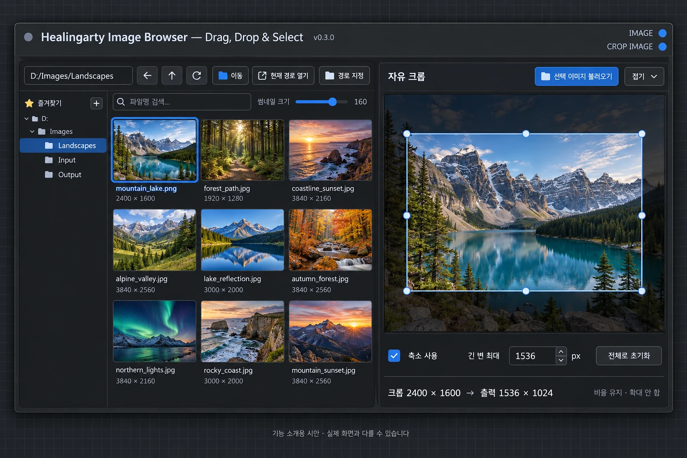

# Healingarty Image Browser — Drag, Drop & Select

**이미지를 찾고, 끌어놓고, 바로 I2I 작업을 이어가세요.**

캔버스 안에 배치하는 이미지 탐색기 커스텀 노드입니다. **Drag & Drop**으로 기존 Load Image에 넣거나, **Select**로 이미지를 클릭하고 탐색기의 IMAGE 출력을 직접 연결할 수 있습니다. 윈도우 탐색기처럼 익숙한 폴더 트리에서 이미지를 고르고, 기존 **Load Image** 노드 위로 썸네일을 드래그하세요. 탐색기와 작업 노드를 한 화면에서 함께 볼 수 있습니다.



> AI로 생성한 기능 소개용 시안입니다. 풍경 이미지를 예시로 사용했으며 실제 UI 배치·문구와 다를 수 있습니다.
>
> **IMAGE**는 선택 원본, **CROP IMAGE**는 오른쪽에서 크롭·축소한 결과를 출력합니다.

## v0.3.5 — Ctrl+휠로 썸네일 크기 조절

사진 목록 위에서 **Ctrl+휠 위로** 굴리면 썸네일을 키우고, **Ctrl+휠 아래로** 굴리면 줄입니다. 위쪽 크기 조절 바와 연동되며, 기존과 같은 80~220px 범위에서 10px씩 바뀝니다. 마지막 크기는 브라우저에 저장합니다. 썸네일 크기만 바꾸며 원본·크롭 출력 해상도는 변경하지 않습니다.

일반 휠은 사진 목록 스크롤, 목록 밖 휠은 ComfyUI 캔버스 탐색, 가운데 버튼 드래그는 화면 이동입니다. Ctrl+휠로 썸네일 크기를 바꿀 때는 목록 스크롤이나 캔버스 확대·축소를 함께 실행하지 않습니다.

**더 불러오기** 버튼은 파란색으로 강조했습니다. 자동 불러오기는 추가하지 않았으며, 버튼을 눌러 다음 묶음을 읽는 기존 방식을 유지합니다.

설치 폴더에서 `git pull` 후 **Ctrl+F5**. 기존 노드를 그대로 사용하세요.

검증: 썸네일 조절 이벤트·방향·크기 제한·슬라이더 연동·설정 저장과 기존 화면 이동·선택·크롭 검사를 통과했습니다. 실제 ComfyUI 화면에서의 조작과 버튼 모양은 추가 확인이 필요합니다.

## v0.3.4 — 커서 위치에 따른 휠 동작

| 커서 위치 / 조작 | 동작 |
| --- | --- |
| 사진 목록 위에서 휠 굴리기 | 사진 목록만 위아래로 스크롤 |
| 경로 트리·상단 버튼·크롭창 등 나머지 노드 영역에서 휠 굴리기 | ComfyUI 캔버스 확대·축소 |
| 노드 어디서든 가운데 휠 버튼을 누르고 드래그 | ComfyUI 캔버스 이동 |

**Shift를 누를 필요가 없습니다.** 사진 목록의 썸네일·파일명·빈 공간·더 불러오기 버튼 위에서는 목록을 스크롤합니다. 목록의 맨 위나 아래에 도달해도 확대·축소로 바뀌지 않습니다. 경로 트리는 일반 휠로 캔버스를 확대·축소하며, 긴 트리는 스크롤바로 이동할 수 있습니다. 캔버스 휠 동작은 ComfyUI 탐색 설정을 따릅니다.

휠 조작 시 확대 미리보기를 닫습니다. 왼쪽 버튼 사진 선택·드래그·크롭과 출력 연결은 유지합니다.

설치 폴더에서 `git pull` 후 **Ctrl+F5**. 기존 노드를 그대로 사용할 수 있습니다.

검증: 사진 목록·썸네일 내부·목록 경계에서 캔버스 휠 전달을 차단하고, 경로 트리·버튼·크롭창에서는 전달하는지 검사했습니다. 휠 방향·좌표·픽셀/줄/페이지 단위와 기존 가운데 버튼·선택·크롭 검사도 통과했습니다. 실제 ComfyUI 화면에서는 추가 확인이 필요합니다.

## 주요 기능

- **캔버스 안의 탐색기** — 노드 이동과 크기 조절
- **유지되는 폴더 트리** — 드라이브·상위 경로 유지, 현재 폴더 강조, 하위 폴더 펼치기·접기
- **원하는 폴더 탐색** — input/output 외 다른 드라이브, 경로 직접 입력
- **클릭 선택과 IMAGE 출력** — 선택 카드를 파란 블록·테두리로 강조하고 생성 시 원본 이미지 전달
- **자유 크롭과 비율 유지 축소** — 오른쪽에서 불러오기·영역 조절 후 CROP IMAGE로 출력, 별도 적용 버튼 없이 생성 시 처리
- **Load Image로 드래그** — 기존 노드의 이미지 선택값과 미리보기 갱신
- **썸네일 크기 조절** — 80~220px, 파일명·해상도·확장자 표시
- **검색과 즐겨찾기** — 파일명 검색, 자주 쓰는 폴더 저장
- **마지막 위치 기억** — 마지막 경로·썸네일 크기·즐겨찾기를 브라우저에 저장
- **원본 유지** — 필요한 경우에만 기본 Load Image용으로 input에 복사

## 설치

### Git으로 설치

ComfyUI의 `custom_nodes` 폴더에서 실행하세요.

```sh
git clone https://github.com/daning1212/Healingarty-Image-Browser-Drag-Drop-Select.git
```

설치 후 **ComfyUI 재시작 → 브라우저 Ctrl+F5**. 캔버스 더블클릭 후 **Healingarty Image Browser**를 검색해 추가하세요.

### ZIP으로 설치

1. 이 저장소의 **Code → Download ZIP**을 선택합니다.
2. 압축을 풀어 `__init__.py`와 `web` 폴더가 든 프로젝트 폴더를 `ComfyUI/custom_nodes/` 안에 넣습니다.
3. ComfyUI를 재시작하고 브라우저를 새로고침합니다.

일반적인 ComfyUI 설치에 포함된 Pillow와 aiohttp를 사용합니다. ComfyUI Manager의 검색 목록에는 아직 등록하지 않았습니다.

## 사용 방법

1. 경로창에 `D:\comfyui\output` 같은 폴더 경로를 입력하고 **Enter / 이동**을 누릅니다.
2. 왼쪽 폴더명으로 이동합니다. **▸ / ▾**는 하위 트리를 펼치거나 접습니다.
3. 파일명 검색과 크기 슬라이더로 원하는 이미지를 찾습니다.
4. 썸네일을 기존 **Load Image** 노드 위로 드래그해 놓습니다.
5. Load Image의 선택 이미지와 미리보기가 바뀌면 평소처럼 생성합니다.

v0.2.1부터 탐색기는 실제 IMAGE 출력을 가진 노드입니다. 출력이 생성 경로에 연결되면 생성 시 선택한 원본을 읽습니다. 클릭만으로 생성을 시작하지 않습니다. 노드 연결은 유지됩니다. 빈 캔버스나 지원하지 않는 노드로 드롭하면 워크플로를 불러오지 않습니다.

| 버튼 | 동작 |
|---|---|
| ← / ↑ / ⟳ | 뒤로 / 상위 폴더 / 새로고침 |
| 경로 지정 | 노드 안에서 드라이브·input·output·홈 바로가기 표시 |
| 현재 경로 열기 | ComfyUI 실행 컴퓨터의 OS 파일 탐색기로 현재 폴더 열기 |
| ☆ 즐겨찾기 | 현재 폴더 추가. 즐겨찾기 우클릭으로 해제 |
| 더 불러오기 | 다음 목록 표시 |

## 경로와 파일 보존

탐색 대상은 **ComfyUI가 실행되는 컴퓨터의 폴더**입니다. 로컬 실행이면 내 PC, 원격 실행이면 원격 컴퓨터 기준입니다. 실행 계정의 파일 권한이 적용됩니다. 폴더를 변경할 때 설정 파일 수정이나 재시작이 필요하지 않습니다.

input 외부 이미지는 드롭할 때만 `input/healingarty_browser/`에 복사하며 원본은 수정하지 않습니다. 동일 경로·수정시각·파일크기의 이미지는 기존 복사본을 재사용합니다. PNG 메타데이터는 보존하지만 드롭 시 워크플로 로더는 호출하지 않습니다.

삭제·이동·일반 파일 복사 기능은 제공하지 않습니다. `현재 경로 열기`는 원격 실행이면 원격 컴퓨터에서 열리며 GUI 없는 환경에서는 동작하지 않을 수 있습니다.

## 많은 이미지가 있는 폴더

파일 목록은 80개 단위, 하위 폴더는 120개 단위로 나눠 표시합니다. 썸네일은 화면 근처 항목부터 최대 4개씩 요청하고 폴더 이동 시 이전 요청을 취소합니다. 정렬을 위해 파일명 전체를 스캔하므로 아주 큰 폴더나 느린 네트워크 드라이브에서는 첫 조회가 느릴 수 있습니다.

## 업데이트 및 문제 해결

설치 폴더에서 `git pull`하거나 Manager의 업데이트 기능을 사용한 뒤 **ComfyUI 재시작 → Ctrl+F5**를 해주세요. 현재 화면의 버전 표시는 **v0.3.1**입니다.

- 화면이 좁게 보이거나 이전 버전 표시가 남으면 Ctrl+F5 후 탐색기 노드를 다시 추가하세요.
- 폴더 조회가 실패하면 경로와 접근 권한을 확인하세요.
- 문제가 계속되면 스크린샷, 오류 문구, ComfyUI 및 프런트엔드 버전을 함께 알려주세요.

## 검증 범위

백엔드 자동 테스트 6개, 프런트엔드 선택·강조·경로 복원·크기 동기화 검사 및 JS 문법 검사를 수행했습니다. Windows 사용 환경에서 화면 동작을 확인하며 개선 중입니다. 실험적 Vue 노드 렌더러와 서브그래프 호환성은 아직 검증하지 않았습니다.

```sh
python -m unittest discover -s tests -v
node tests/test_frontend.mjs
node --input-type=module --check < web/browser.js
```

이 확장은 실행 계정이 접근 가능한 폴더를 탐색합니다. 신뢰할 수 있는 로컬 환경용이며 인증 없는 ComfyUI를 인터넷에 공개하지 마세요.

---

[힐링아티의 다른 도구 보기](https://daning1212.github.io/healingarty/#tools)

## v0.2.1 — Select로 직접 연결

1. 업데이트 후 ComfyUI 재시작 → Ctrl+F5.
2. 이전 탐색기 노드를 삭제하고 새로 추가하세요. 기존에는 출력 단자가 없는 화면 전용 노드였기 때문에 새 노드로 교체해야 IMAGE 단자가 표시됩니다.
3. 탐색기의 **IMAGE** 출력을 이미지 입력(예: VAE Encode의 pixels)에 연결합니다.
4. 원하는 썸네일을 클릭하세요. 선택한 카드 전체가 파란 블록과 밝은 테두리로 강조됩니다.
5. 생성하면 선택한 원본을 RGB 이미지 텐서로 전달합니다. 썸네일 해상도가 아닌 원본 해상도를 사용합니다.

선택 경로는 워크플로에 저장됩니다. 폴더를 이동해도 선택은 유지되며, 같은 파일이 다시 보이면 강조됩니다. 파일을 삭제하거나 다른 컴퓨터에서 경로가 없으면 오류를 표시합니다. 선택하지 않은 상태에서 연결해 생성하면 이미지 선택 안내가 나옵니다. 파일 내용이 바뀌면 캐시를 갱신합니다.

Select 출력은 원본을 직접 읽으므로 input 복사가 필요 없습니다. 드래그해서 기존 Load Image에 넣는 기능은 그대로 유지합니다. 애니메이션·다중 페이지 이미지는 첫 프레임만 출력하며 투명도는 RGB 변환됩니다. MASK 출력은 제공하지 않습니다.

출력 테스트는 이 환경에 PyTorch가 없어 텐서 변환 어댑터를 대체해 픽셀값·배열 크기·파일 변경 감지를 확인했습니다. 실제 ComfyUI/PyTorch 실행과 저장된 이전 워크플로 호환성은 사용자 환경에서 추가 확인이 필요합니다.

## 마우스 오버 확대 미리보기 (v0.2.1)

썸네일 위에 마우스를 약 0.4초 올려두면 약 6배 크기의 확대 이미지가 나타납니다. 화면 크기에 맞춰 최대 크기를 제한하며 사진 비율은 유지합니다. 작은 썸네일 파일을 늘리는 대신 원본에서 최대 2048px 미리보기를 읽습니다. 마우스를 떼거나 스크롤·드래그·폴더 이동·Esc 입력 시 닫힙니다. 확대 미리보기는 선택 이미지를 바꾸거나 생성을 실행하지 않습니다.

**출력 연결:** 기본 Load Image는 IMAGE 입력이 없는 로더입니다. 탐색기의 IMAGE를 Load Image에 연결하는 대신, Load Image가 연결돼 있던 다음 노드(예: VAE Encode의 pixels)에 연결하세요. 기존 Load Image를 계속 사용할 때는 썸네일 드래그 방식을 사용하면 됩니다.

업데이트 후 ComfyUI 재시작과 Ctrl+F5가 필요합니다. 기존 v0.2.x 노드의 출력 구조는 동일합니다.


## v0.3.0 — 자유 크롭과 선택적 축소

탐색기 오른쪽에 독립된 크롭 편집창을 추가했습니다. Olm 코드를 사용하지 않은 자체 구현입니다.

**업데이트 후 ComfyUI 재시작 → Ctrl+F5 → 탐색기 노드를 새로 추가하세요.** 출력이 두 개로 늘어나므로 기존 노드 교체를 권장합니다. 첫 번째 IMAGE는 기존과 같은 선택 원본 출력입니다.

1. 왼쪽에서 사진을 선택하고 오른쪽 **선택 이미지 불러오기**를 누릅니다. 생성 실행 없이 미리보기를 불러옵니다.
2. 모서리·변의 핸들로 자유롭게 크기를 조절하거나 영역 내부를 끌어 이동합니다. 영역 바깥 또는 **Shift+드래그**로 새 영역을 그립니다.
3. 필요한 경우 **축소 사용**을 켜고 긴 변의 최대 픽셀을 입력합니다. 기본은 축소하지 않으며, 축소 시 비율을 유지하고 Lanczos를 사용합니다. 작은 이미지를 확대하지 않습니다.
4. **CROP IMAGE**를 작업 노드에 연결하고 생성합니다. 별도 적용 버튼 없이 현재 저장된 좌표로 원본을 자르고 축소합니다.

왼쪽 선택을 바꿔도 오른쪽 작업은 유지됩니다. 불러오기 성공 시에만 새 이미지로 교체하며, 전체로 초기화는 크롭 영역만 전체 이미지로 되돌립니다. 크롭하지 않고 축소만 할 수도 있습니다. 창 접기·펼치기와 가운데 경계 드래그로 공간을 조절합니다.

크롭 이미지 경로·원본 해상도·영역·축소 설정은 숨겨진 `crop_state` 위젯을 통해 워크플로에 저장됩니다. 다시 열면 저장된 미리보기를 복원합니다. 원본 해상도가 달라지면 조용히 다른 영역을 자르지 않고 다시 불러오라는 오류를 표시합니다. 원본 파일은 덮어쓰지 않습니다. 크롭을 아직 불러오지 않았다면 CROP IMAGE도 왼쪽 선택 원본을 출력합니다.

미리보기는 최대 2048px이며 실제 출력은 원본에서 처리합니다. 화면의 미리보기 품질과 출력 품질은 다를 수 있고, 축소에는 세부 정보 손실이 있습니다. 이미지별 실행 결과는 사용하는 모델과 전처리 노드에 따라 달라집니다. 파일 목록의 80개 단위 더 불러오기 및 썸네일 지연 로딩은 유지합니다.

### 이번 변경의 검증 범위

백엔드 테스트 8개, 기존 프런트엔드 검사, 원본 좌표 변환·영역 이동 및 크기 조절·비율 유지 축소 검사와 JS 문법 검사를 통과했습니다. PyTorch 변환은 테스트 어댑터로 확인했습니다. 실제 ComfyUI 및 브라우저 렌더링·포인터 통합 검증은 아직 수행하지 못했습니다. Playwright 브라우저가 없고 설치 다운로드가 실패해 화면 검증이 차단되었습니다. Vue 렌더러·서브그래프도 미검증입니다.

```sh
python -m unittest discover -s tests -v
node tests/test_frontend.mjs
node tests/test_crop.mjs
node --input-type=module --check < web/browser.js
node --input-type=module --check < web/crop.js
```


## v0.3.1 — 크롭 손잡이 조작 개선

- 처음 불러온 사진의 가장자리에서 손잡이 바깥쪽을 눌렀을 때 드래그가 시작되지 않던 문제를 수정했습니다. 사진 경계보다 손잡이를 먼저 확인합니다.
- 손잡이를 8px에서 화면 기준 약 12px로 확대하고, 클릭 가능한 범위를 약 28 × 28px로 넓혔습니다.
- 노드를 확대·축소해도 손잡이 크기와 클릭 범위를 화면 기준으로 유지하도록 보정합니다. 가장자리 여백도 함께 확보합니다.
- 마우스를 올리거나 드래그 중인 손잡이는 노란색으로 강조합니다. 작은 영역에서 클릭 범위가 겹치면 가장 가까운 손잡이를 선택합니다.

설치 폴더에서 `git pull` 후 브라우저 **Ctrl+F5**로 갱신하세요. 출력과 저장 형식은 v0.3.0과 같으며 이번 변경은 프런트엔드 수정입니다.

검증: 기존 백엔드·프런트엔드·크롭 테스트와 JS 문법 검사, 가장자리 바깥 클릭·8방향 드래그·축소 및 확대 좌표 보정 회귀 테스트를 수행했습니다. 실제 ComfyUI 화면에서의 확인은 추가로 필요합니다.


## v0.3.2 — 노드 위에서 휠 버튼으로 화면 이동

이미지 탐색기 안에서도 **마우스 가운데 휠 버튼을 누른 채 드래그**하면 ComfyUI 캔버스를 이동할 수 있도록 수정했습니다. 사진·폴더·버튼·크롭창·너비 조절선 위에서 시작할 수 있습니다. 이동을 시작하면 확대 미리보기가 닫힙니다.

- 왼쪽 버튼의 사진 선택·썸네일 드래그·크롭 조작은 유지합니다.
- v0.3.2에서는 사진 목록의 일반 휠 스크롤을 유지했습니다. v0.3.3의 Shift+휠 방식은 v0.3.4에서 커서 위치에 따른 동작으로 교체했습니다. 현재 동작은 위의 v0.3.4 안내를 참고하세요.
- 너비 조절선은 왼쪽 버튼에만 반응합니다.
- 버튼을 놓거나 창이 포커스를 잃거나 노드를 삭제하면 이동 처리를 정리합니다.

설치 폴더에서 `git pull` 후 브라우저 **Ctrl+F5**로 갱신하세요. 출력과 저장 형식은 변경하지 않았으므로 기존 노드를 계속 사용할 수 있습니다.

검증: 백엔드 8개 검사, 기존 선택·미리보기·크롭 검사, 가운데 버튼 이벤트 전달·확대 배율에서의 이동·노드 밖 드래그·중복 이동 방지·취소와 정리 검사를 통과했습니다. 실제 ComfyUI 브라우저에서 손 커서·화면 이동과 Vue 렌더러 동작은 추가 확인이 필요합니다.

```sh
node tests/test_pan.mjs
```


### v0.3.6 — 폴더 휠 스크롤 / 클립보드 붙여넣기

- 왼쪽 폴더 트리 위에서 휠을 굴리면 폴더 목록을 스크롤합니다.
- 스크린샷을 복사하고 갤러리의 이미지 영역 또는 빈 곳을 클릭한 뒤 Ctrl+V를 누르면 현재 폴더에 PNG로 저장합니다.
- 파일명은 자동 생성하여 기존 파일을 덮어쓰지 않습니다. 텍스트 입력창의 붙여넣기는 유지합니다.
- 쓰기 권한이 있는 폴더가 필요합니다. 이미지는 ComfyUI 실행 컴퓨터에 저장됩니다.
- 업데이트: git pull → ComfyUI 재시작 → 브라우저 Ctrl+F5.
