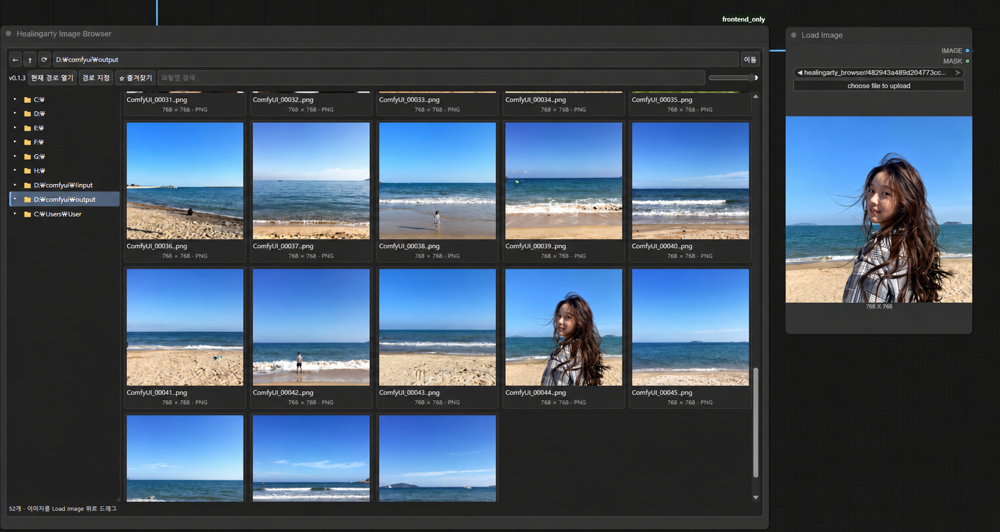

# Healingarty Image Browser — Drag, Drop & Select

**이미지를 찾고, 끌어놓고, 바로 I2I 작업을 이어가세요.**

캔버스 안에 배치하는 이미지 탐색기 커스텀 노드입니다. **Drag & Drop**으로 기존 Load Image에 넣거나, **Select**로 이미지를 클릭하고 탐색기의 IMAGE 출력을 직접 연결할 수 있습니다. 윈도우 탐색기처럼 익숙한 폴더 트리에서 이미지를 고르고, 기존 **Load Image** 노드 위로 썸네일을 드래그하세요. 탐색기와 작업 노드를 한 화면에서 함께 볼 수 있습니다.



> 소개 이미지는 개인 경로를 예시 경로로 바꾼 이미지입니다.

## 주요 기능

- **캔버스 안의 탐색기** — 노드 이동과 크기 조절
- **유지되는 폴더 트리** — 드라이브·상위 경로 유지, 현재 폴더 강조, 하위 폴더 펼치기·접기
- **원하는 폴더 탐색** — input/output 외 다른 드라이브, 경로 직접 입력
- **클릭 선택과 IMAGE 출력** — 선택 카드를 파란 블록·테두리로 강조하고 생성 시 원본 이미지 전달
- **Load Image로 드래그** — 기존 노드의 이미지 선택값과 미리보기 갱신
- **썸네일 크기 조절** — 80~220px, 파일명·해상도·확장자 표시
- **검색과 즐겨찾기** — 파일명 검색, 자주 쓰는 폴더 저장
- **마지막 위치 기억** — 마지막 경로·썸네일 크기·즐겨찾기를 브라우저에 저장
- **원본 유지** — 필요한 경우에만 기본 Load Image용으로 input에 복사

## 설치

### Git으로 설치

ComfyUI의 `custom_nodes` 폴더에서 실행하세요.

```sh
git clone https://github.com/daning1212/Healingarty-Image-Browser-Drag-Drop-Select.git
```

설치 후 **ComfyUI 재시작 → 브라우저 Ctrl+F5**. 캔버스 더블클릭 후 **Healingarty Image Browser**를 검색해 추가하세요.

### ZIP으로 설치

1. 이 저장소의 **Code → Download ZIP**을 선택합니다.
2. 압축을 풀어 `__init__.py`와 `web` 폴더가 든 프로젝트 폴더를 `ComfyUI/custom_nodes/` 안에 넣습니다.
3. ComfyUI를 재시작하고 브라우저를 새로고침합니다.

일반적인 ComfyUI 설치에 포함된 Pillow와 aiohttp를 사용합니다. ComfyUI Manager의 검색 목록에는 아직 등록하지 않았습니다.

## 사용 방법

1. 경로창에 `D:\comfyui\output` 같은 폴더 경로를 입력하고 **Enter / 이동**을 누릅니다.
2. 왼쪽 폴더명으로 이동합니다. **▸ / ▾**는 하위 트리를 펼치거나 접습니다.
3. 파일명 검색과 크기 슬라이더로 원하는 이미지를 찾습니다.
4. 썸네일을 기존 **Load Image** 노드 위로 드래그해 놓습니다.
5. Load Image의 선택 이미지와 미리보기가 바뀌면 평소처럼 생성합니다.

v0.2.0부터 탐색기는 실제 IMAGE 출력을 가진 노드입니다. 출력이 생성 경로에 연결되면 생성 시 선택한 원본을 읽습니다. 클릭만으로 생성을 시작하지 않습니다. 노드 연결은 유지됩니다. 빈 캔버스나 지원하지 않는 노드로 드롭하면 워크플로를 불러오지 않습니다.

| 버튼 | 동작 |
|---|---|
| ← / ↑ / ⟳ | 뒤로 / 상위 폴더 / 새로고침 |
| 경로 지정 | 노드 안에서 드라이브·input·output·홈 바로가기 표시 |
| 현재 경로 열기 | ComfyUI 실행 컴퓨터의 OS 파일 탐색기로 현재 폴더 열기 |
| ☆ 즐겨찾기 | 현재 폴더 추가. 즐겨찾기 우클릭으로 해제 |
| 더 불러오기 | 다음 목록 표시 |

## 경로와 파일 보존

탐색 대상은 **ComfyUI가 실행되는 컴퓨터의 폴더**입니다. 로컬 실행이면 내 PC, 원격 실행이면 원격 컴퓨터 기준입니다. 실행 계정의 파일 권한이 적용됩니다. 폴더를 변경할 때 설정 파일 수정이나 재시작이 필요하지 않습니다.

input 외부 이미지는 드롭할 때만 `input/healingarty_browser/`에 복사하며 원본은 수정하지 않습니다. 동일 경로·수정시각·파일크기의 이미지는 기존 복사본을 재사용합니다. PNG 메타데이터는 보존하지만 드롭 시 워크플로 로더는 호출하지 않습니다.

삭제·이동·일반 파일 복사 기능은 제공하지 않습니다. `현재 경로 열기`는 원격 실행이면 원격 컴퓨터에서 열리며 GUI 없는 환경에서는 동작하지 않을 수 있습니다.

## 많은 이미지가 있는 폴더

파일 목록은 80개 단위, 하위 폴더는 120개 단위로 나눠 표시합니다. 썸네일은 화면 근처 항목부터 최대 4개씩 요청하고 폴더 이동 시 이전 요청을 취소합니다. 정렬을 위해 파일명 전체를 스캔하므로 아주 큰 폴더나 느린 네트워크 드라이브에서는 첫 조회가 느릴 수 있습니다.

## 업데이트 및 문제 해결

설치 폴더에서 `git pull`하거나 Manager의 업데이트 기능을 사용한 뒤 **ComfyUI 재시작 → Ctrl+F5**를 해주세요. 현재 화면의 버전 표시는 **v0.2.0**입니다.

- 화면이 좁게 보이거나 이전 버전 표시가 남으면 Ctrl+F5 후 탐색기 노드를 다시 추가하세요.
- 폴더 조회가 실패하면 경로와 접근 권한을 확인하세요.
- 문제가 계속되면 스크린샷, 오류 문구, ComfyUI 및 프런트엔드 버전을 함께 알려주세요.

## 검증 범위

백엔드 자동 테스트 5개, 프런트엔드 선택·강조·경로 복원·크기 동기화 검사 및 JS 문법 검사를 수행했습니다. Windows 사용 환경에서 화면 동작을 확인하며 개선 중입니다. 실험적 Vue 노드 렌더러와 서브그래프 호환성은 아직 검증하지 않았습니다.

```sh
python -m unittest discover -s tests -v
node tests/test_frontend.mjs
node --input-type=module --check < web/browser.js
```

이 확장은 실행 계정이 접근 가능한 폴더를 탐색합니다. 신뢰할 수 있는 로컬 환경용이며 인증 없는 ComfyUI를 인터넷에 공개하지 마세요.

---

[힐링아티의 다른 도구 보기](https://daning1212.github.io/healingarty/#tools)

## v0.2.0 — Select로 직접 연결

1. 업데이트 후 ComfyUI 재시작 → Ctrl+F5.
2. 이전 탐색기 노드를 삭제하고 새로 추가하세요. 기존에는 출력 단자가 없는 화면 전용 노드였기 때문에 새 노드로 교체해야 IMAGE 단자가 표시됩니다.
3. 탐색기의 **IMAGE** 출력을 이미지 입력(예: VAE Encode의 pixels)에 연결합니다.
4. 원하는 썸네일을 클릭하세요. 선택한 카드 전체가 파란 블록과 밝은 테두리로 강조됩니다.
5. 생성하면 선택한 원본을 RGB 이미지 텐서로 전달합니다. 썸네일 해상도가 아닌 원본 해상도를 사용합니다.

선택 경로는 워크플로에 저장됩니다. 폴더를 이동해도 선택은 유지되며, 같은 파일이 다시 보이면 강조됩니다. 파일을 삭제하거나 다른 컴퓨터에서 경로가 없으면 오류를 표시합니다. 선택하지 않은 상태에서 연결해 생성하면 이미지 선택 안내가 나옵니다. 파일 내용이 바뀌면 캐시를 갱신합니다.

Select 출력은 원본을 직접 읽으므로 input 복사가 필요 없습니다. 드래그해서 기존 Load Image에 넣는 기능은 그대로 유지합니다. 애니메이션·다중 페이지 이미지는 첫 프레임만 출력하며 투명도는 RGB 변환됩니다. MASK 출력은 제공하지 않습니다.

출력 테스트는 이 환경에 PyTorch가 없어 텐서 변환 어댑터를 대체해 픽셀값·배열 크기·파일 변경 감지를 확인했습니다. 실제 ComfyUI/PyTorch 실행과 저장된 이전 워크플로 호환성은 사용자 환경에서 추가 확인이 필요합니다. 위 소개 이미지는 v0.1.3 화면이며 새 IMAGE 단자와 선택 강조는 포함하지 않습니다.
